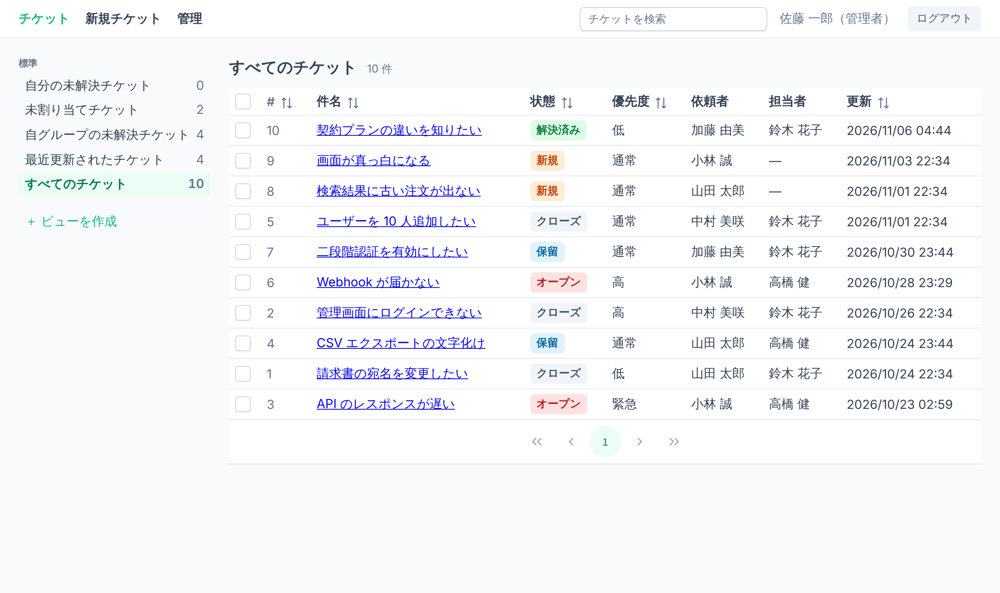
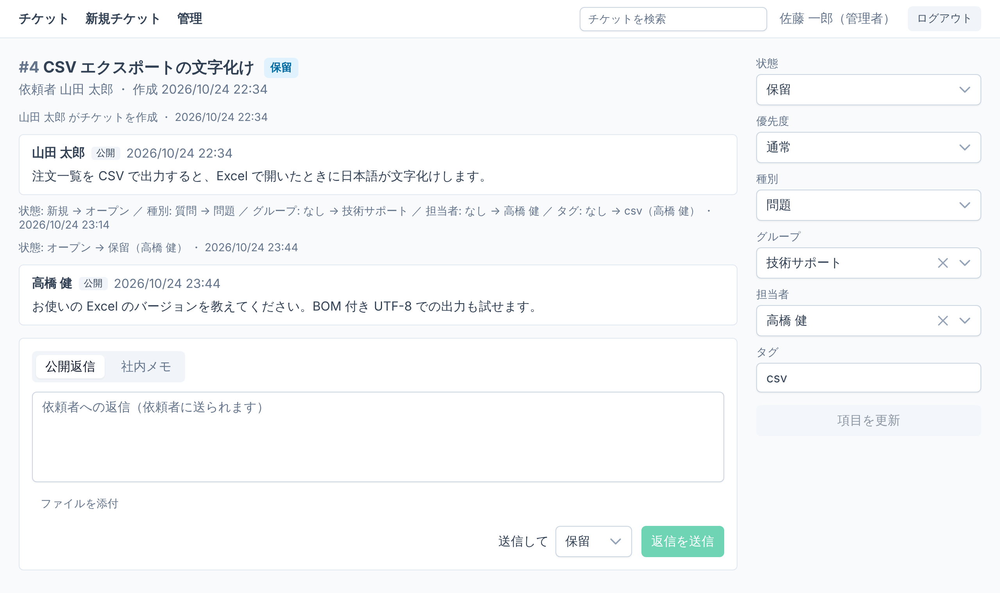
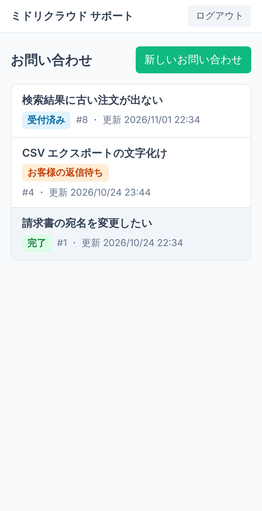
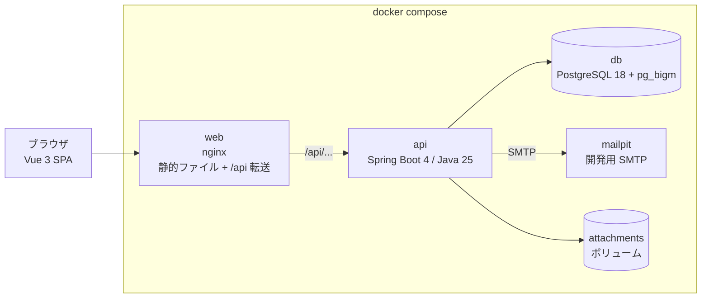

# like-zendesk

Zendesk ライクなインシデント管理システムです。問い合わせをチケットとして受け付け、担当の割り当て、ステータス管理、コメントでのやり取り、解決後の自動クローズまでを扱います。1 つのシステムを複数の組織（テナント）が使う、多テナント SaaS として作っています。

社外の顧客サポート窓口と、社内の IT ヘルプデスクの両方を想定しています。



| チケット詳細（エージェント） | 依頼者ポータル（スマートフォン） |
| --- | --- |
|  |  |

## 主な機能

- **テナント**: サインアップ画面でテナントを作成。URL は `/t/{テナント識別子}/...`。依頼者の登録を誰でも可能にするか、許可したメールドメインだけにするかを選べる。
- **ユーザー**: 管理者・エージェント・依頼者の 3 ロール。エージェントはメールで招待し、依頼者はポータルで自己登録する（メールアドレスの確認つき）。パスワードの再設定。
- **チケット**: 作成、項目の変更（状態、優先度、種別、グループ、担当者、タグ）、公開返信と社内メモ、添付ファイル、一括更新。同時編集は楽観ロックで検出する。
- **ステータス遷移**: 新規 → オープン → 保留 / 待機 → 解決済み → クローズ。担当者を決めると自動でオープンになり、依頼者が返信すると保留からオープンに戻る。解決から 4 日たつと自動でクローズする。クローズ後に依頼者が返信すると、続きのチケットを新しく起票する。
- **監査ログ**: 項目の変更を、誰がいつ何を何から何に変えたかの形で記録し、コメントと時系列で表示する。
- **ビューと検索**: 標準・共有・個人のビュー（保存済みの絞り込み条件、件数つき）、列での並べ替え、件名・本文・コメントの全文検索（日本語の部分一致）。
- **通知メール**: 受付、公開返信、担当の割り当て。
- **依頼者ポータル**: 問い合わせの起票、自分の問い合わせの一覧・詳細（公開コメントだけ）、返信、解決。スマートフォン対応。
- **管理画面**: ユーザー（ロール、有効・無効、所属組織）、グループとメンバー、所属組織、テナント設定。

要件は[要件定義書](docs/requirements.md)、設計は[設計ドキュメント](docs/design/README.md)にまとめています。

## 起動

Docker があれば、次の 1 コマンドで全体が起動します。初回はイメージのビルドに数分かかります。

```sh
docker compose up --build
```

| URL | 内容 |
| --- | --- |
| http://localhost:8080/t/demo-support/login | デモテナント（社外サポート） |
| http://localhost:8080/t/demo-helpdesk/login | デモテナント（社内ヘルプデスク） |
| http://localhost:8080/signup | 新しいテナントを作る |
| http://localhost:8025 | Mailpit（送られたメールを見る画面） |
| http://localhost:8080/api/docs | OpenAPI 定義 |

### デモアカウント

起動時に 2 つのデモテナントを作ります（2 回目以降の起動ではそのまま残ります）。パスワードはすべて `demo-password` です。

| テナント | ロール | メールアドレス |
| --- | --- | --- |
| `demo-support`（ミドリクラウド サポート） | 管理者 | `admin@support.example.com` |
| | エージェント | `suzuki@support.example.com`、`takahashi@support.example.com` |
| | 依頼者 | `yamada@sample-shoji.example.jp`、`kato@example.net` |
| `demo-helpdesk`（情報システム部 ヘルプデスク） | 管理者 | `ito@corp.example.co.jp` |
| | エージェント | `watanabe@corp.example.co.jp`、`yamamoto@corp.example.co.jp` |
| | 依頼者 | `tanaka@corp.example.co.jp`、`yoshida@corp.example.co.jp` |

チケットは過去 3 週間に散らばっていて、新規・オープン・保留・解決済み・クローズが揃っています。`demo-helpdesk` は依頼者の登録を `corp.example.co.jp` のアドレスに限っています。

### 10 万件のデータで試す

性能確認用のテナント `demo-load`（チケット 10 万件、エージェント 20 人、依頼者 500 人）を作れます。API を起動した状態で実行してください。

```sh
docker compose run --rm -e APP_SEED=load -e APP_SEED_EXIT=true api
```

管理者は `admin@load.example.com` / `demo-password` です。手元の計測では、一覧・詳細の API が 100ms 以内、全文検索が 200ms 程度で応答します（要件 N-1: 500ms、N-2: 1 秒）。

## アーキテクチャ



| 層 | 技術 |
| --- | --- |
| フロントエンド | Vue 3、TypeScript、Vite、PrimeVue、TanStack Query、openapi-fetch（OpenAPI から生成した型） |
| バックエンド | Java 25、Spring Boot 4、Spring Security、JdbcClient（ORM なし）、Flyway、Maven |
| データベース | PostgreSQL 18、pg_bigm（日本語の部分一致検索） |
| テスト | JUnit 5、Testcontainers、ArchUnit、Vitest、Playwright |
| CI | GitHub Actions（backend、frontend、compose の起動確認、E2E） |

画面と API は同じオリジン（`http://localhost:8080`）で提供するので、Cookie のセッションを `SameSite=Lax` のまま使え、CORS の設定が要りません。API は 1 つのプロセスで、HTTP の処理と定期ジョブ（自動クローズ、メール送信、未使用の添付の削除）の両方を担います。

## 設計上の判断

主なものを挙げます。全体は[設計ドキュメント](docs/design/README.md#1-主な設計判断)にあります。

### テナント分離はアプリケーションの SQL で行う

全テナントが同じスキーマを共有し、すべての表に `tenant_id` を持たせています。分離は PostgreSQL の行レベルセキュリティ（RLS）ではなく、アプリケーションの SQL で行います。漏れを防ぐために、次の 4 つを組み合わせています。

1. **閲覧者の型**: 呼び出し元を `Viewer`（依頼者・エージェント・管理者・システム）という sealed interface で表し、サービスとリポジトリは扱える型だけを引数に取ります。依頼者に許されない操作を依頼者として呼ぶコードは、コンパイルが通りません。
2. **可視性条件を 1 か所に**: 「この閲覧者が見てよい行」の WHERE 句をエンティティごとに 1 つのクラスで作り、すべての SQL がそれを使います。`switch` の網羅性検査で、ロールを増やしたときの書き漏れがコンパイルエラーになります。
3. **ArchUnit**: リポジトリの public メソッドは第 1 引数に `Viewer` を取る、というルールをテストで強制しています。

4. **全エンドポイントの結合テスト**: OpenAPI 定義からエンドポイントの一覧を取り、他テナントのリソース ID、他テナントのセッション、同じテナントの別の依頼者のそれぞれで呼んで、404 / 401 になることを確かめます（`TenantIsolationIT`）。エンドポイントを足すと自動で対象に入ります。

見えないリソースへのアクセスは 403 ではなく 404 を返し、存在を漏らしません。E2E では、別の依頼者や別テナントの管理者が URL 直打ちでも API でもチケットを見られないことを確かめています。

### 不変条件をデータベースでも守る

- 「担当者は担当グループのメンバー」「解決済み・クローズには担当者が要る」「クローズなら `closed_at` がある」などを、CHECK 制約と外部キーで表しています。ドメイン層に誤りがあってもデータは壊れません。
- 監査ログとコメントは追記のみです。API の DB ロールには UPDATE / DELETE の権限を与えていません。

### その他

- **通知は Transactional Outbox**: チケットの更新と同じトランザクションで送信待ちの表に書き、定期ジョブが送ります。SMTP が止まっていても更新は失敗しません。
- **楽観ロック**: チケットに `version` を持たせ、他の人の更新を上書きしそうなときは 409 を返して最新の内容を読み直させます。
- **依頼者向け API を分ける**: 依頼者は `/portal/...` の API だけを使い、担当グループ、タグ、社内メモ、監査ログを含まない別の応答を受け取ります。
- **時計を差し替えられる**: 現在時刻は `Clock` Bean から取ります。E2E では時計を進める API（`e2e` プロファイルのみ）で「解決から 4 日後の自動クローズ」を確かめます。

## 開発

必要なもの: Java 25、Node.js 22、Docker。

```sh
docker compose up -d db mailpit           # DB とメールだけをコンテナで動かす
(cd backend && SPRING_PROFILES_ACTIVE=dev APP_SEED=demo APP_BASE_URL=http://localhost:5173 ./mvnw spring-boot:run)  # API: http://localhost:8081
(cd frontend && npm install && npm run dev)  # 画面: http://localhost:5173（/api は 8081 へ転送）
```

`SPRING_PROFILES_ACTIVE=dev APP_SEED=demo` を付けるとデモデータを入れます。`APP_BASE_URL` はメールに載せるリンクの起点です。

### テスト

```sh
(cd backend && ./mvnw verify)   # 整形の検査、単体・アーキテクチャテスト、結合テスト（Docker が必要）
(cd frontend && npm run lint && npm run typecheck && npm test)
```

E2E（要件定義書 9 章の受け入れ基準 1〜13）は、`e2e` プロファイルで起動した環境に対して実行します。

```sh
docker compose -f compose.yaml -f compose.e2e.yaml up --build --detach --wait
(cd e2e && npm install && npx playwright install chromium && npx playwright test)
```

API を変えたら、OpenAPI 定義とフロントエンドの型を生成し直してコミットします（CI がずれを検査します）。

```sh
(cd backend && ./mvnw verify -Dopenapi.update=true)   # frontend/src/api/openapi.json を書き直す
(cd frontend && npm run gen:api)                      # src/api/schema.d.ts を生成する
```

## ディレクトリ構成

| ディレクトリ | 内容 |
| --- | --- |
| `backend/` | Spring Boot（機能ごとのパッケージ。各機能の中を web / app / domain / infra に分ける）。マイグレーションは `src/main/resources/db/migration` |
| `frontend/` | Vue 3 + TypeScript（Vite）。エージェント画面と依頼者ポータルを 1 つの SPA に入れている |
| `e2e/` | Playwright（受け入れ基準のシナリオ） |
| `docker/` | PostgreSQL + pg_bigm、API、画面（nginx）のイメージ |
| `docs/` | 要件定義書、設計ドキュメント |
