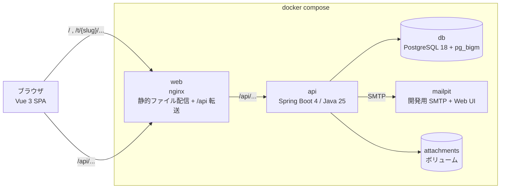
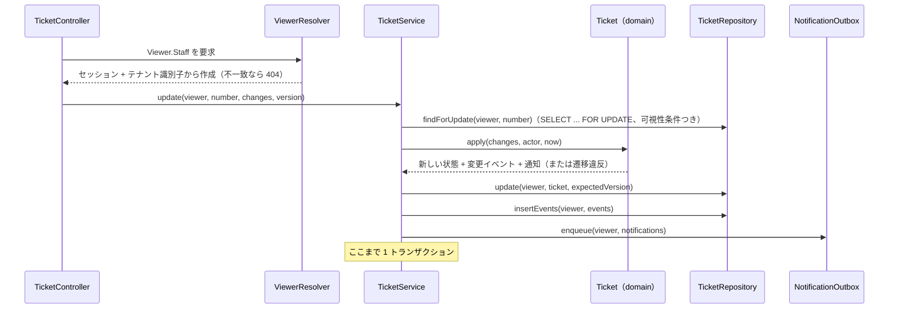

# アーキテクチャ設計

- 版: v0.1（2026-10-17）
- 前提: [要件定義書](../requirements.md) v0.3

## 1. 全体構成



- 画面と API を同じオリジン（`http://localhost:8080`）で提供する。Cookie を `SameSite=Lax` のまま使え、CORS 設定が要らない。
- 開発時は `web` の代わりに Vite の開発サーバーを使い、`/api` を `api` に転送する。
- `api` は 1 つのプロセスで、HTTP リクエストの処理と定期ジョブ（自動クローズ、メール送信）の両方を担う。
- PostgreSQL は pg_bigm を組み込んだ独自イメージ（`docker/postgres/Dockerfile`）を使う。

### 1.1 リポジトリ構成

```
like-zendesk/
├── compose.yaml
├── docker/
│   ├── postgres/Dockerfile        # PostgreSQL 18 + pg_bigm
│   └── web/                       # nginx 設定、フロントエンドのビルド
├── backend/                       # Spring Boot（Gradle）
├── frontend/                      # Vue 3（Vite）
├── e2e/                           # Playwright（受け入れ基準のシナリオ）
├── docs/
│   ├── requirements.md
│   └── design/
└── .github/workflows/ci.yml
```

## 2. バックエンド

### 2.1 モジュール構成

機能ごとにパッケージを分ける（package-by-feature）。各機能の中を `web` / `app` / `domain` / `infra` の 4 層に分ける。

```
dev.likezendesk
├── shared            # Viewer、可視性条件の部品、ID 型、Clock、エラー応答
├── tenant            # テナントのサインアップ、設定、テナント識別子の解決
├── identity          # ユーザー、認証、招待、依頼者登録、グループ、所属組織
├── ticket            # チケット、コメント、添付、監査ログ、ステータス遷移、自動クローズ
├── view              # ビュー（保存済みフィルタ）、検索条件から SQL への変換、全文検索
├── notification      # 通知の Outbox、メール送信ジョブ、メール本文
└── devtools          # デモデータ投入、10 万件生成、E2E 用の時計操作（dev / e2e プロファイルのみ）
```

| 層 | 役割 | 依存してよい先 |
| --- | --- | --- |
| `web` | コントローラー、リクエスト／レスポンスの DTO、入力検証 | `app`、`domain`、`shared` |
| `app` | ユースケース。トランザクション境界。 | `domain`、`infra`、`shared` |
| `domain` | 業務ルール（ステータス遷移など）。Spring にも DB にも依存しない純粋な Java。 | `shared` |
| `infra` | リポジトリ（`JdbcClient` による SQL）、ファイル保存、SMTP | `domain`、`shared` |

機能をまたぐ呼び出しは、相手の `app` 層の公開クラスだけを経由する。ArchUnit でこの依存方向を検査する。

### 2.2 閲覧者（Viewer）

要件 6.1 の `Viewer` を、ロールごとの型に分けた sealed interface にする。権限の検査をコンパイル時に寄せるためである。

```java
public sealed interface Viewer permits Viewer.Requester, Viewer.Staff, Viewer.System {
    TenantId tenantId();

    /** 依頼者。自分のチケットの公開情報だけを扱える。 */
    record Requester(TenantId tenantId, UserId userId) implements Viewer {}

    /** エージェントまたは管理者。 */
    sealed interface Staff extends Viewer permits Agent, Admin {
        UserId userId();
    }
    record Agent(TenantId tenantId, UserId userId) implements Staff {}
    record Admin(TenantId tenantId, UserId userId) implements Staff {}

    /** 定期ジョブ。テナント内の全データを扱える。監査ログの実行者は「システム」になる。 */
    record System(TenantId tenantId) implements Viewer {}
}
```

- サービスとリポジトリのメソッドは、扱える閲覧者の型を引数に取る。例えば管理者だけの操作は `Viewer.Admin` を、エージェントの操作は `Viewer.Staff` を取る。依頼者の `Viewer` を渡すコードはコンパイルが通らない。
- コントローラーは `Viewer` を引数に宣言するだけでよい。`HandlerMethodArgumentResolver` がセッションと URL のテナント識別子から `Viewer` を作り、宣言された型に合わなければ 404 を返す（403 ではなく 404 にして、リソースの存在を漏らさない）。
- 定期ジョブは、テナント一覧（テナントのデータではない）を取得したあと、テナントごとに `Viewer.System` を作って処理する。

### 2.3 可視性条件

可視性の条件は、エンティティごとに 1 つのクラスで定義する。各リポジトリはその戻り値を WHERE 句に結合する。

```java
/** SQL の断片とそのパラメーター。名前付きパラメーターの名前は v_ で始め、呼び出し側と衝突させない。 */
public record SqlCondition(String sql, Map<String, Object> params) {}

final class TicketVisibility {
    /** alias はチケット表の別名（例: "t"）。 */
    static SqlCondition of(Viewer viewer, String alias) {
        return switch (viewer) {
            case Viewer.Requester r -> new SqlCondition(
                alias + ".tenant_id = :v_tenant AND " + alias + ".requester_id = :v_user",
                Map.of("v_tenant", r.tenantId().value(), "v_user", r.userId().value()));
            case Viewer.Staff s -> new SqlCondition(
                alias + ".tenant_id = :v_tenant", Map.of("v_tenant", s.tenantId().value()));
            case Viewer.System s -> new SqlCondition(
                alias + ".tenant_id = :v_tenant", Map.of("v_tenant", s.tenantId().value()));
        };
    }
}
```

- `switch` は sealed interface に対して網羅的なので、ロールを追加すると全ての可視性クラスがコンパイルエラーになり、条件の書き漏れを防げる。
- `CommentVisibility` は `TicketVisibility` に、依頼者の場合だけ `public = true` を加える。添付は親コメントの条件を使う。
- 更新系の SQL にも同じ条件を付け、更新件数 0 件を `NotFoundException`（404）に変換する。

条件漏れを検出する仕組み（要件 6.1）:

1. 可視性クラスの単体テスト（ロールごとに生成される SQL とパラメーター）。
2. 結合テスト。全エンドポイントの一覧を OpenAPI 定義から取り出し、他テナント・他依頼者のリソース ID で呼び出して 404 になることを確かめる。エンドポイントを追加すると自動でテスト対象に入る。
3. ArchUnit。`infra` パッケージのリポジトリクラスの public メソッドは、第 1 引数に `Viewer`（またはそのサブタイプ）を取ること。テナントをまたぐ処理用の例外は `TenantDirectory`（テナント一覧と識別子の解決）だけとし、ArchUnit のルールで名指しする。

### 2.4 リクエストの流れ

チケットを更新する場合:



- 業務ルールの判定は `domain` の純粋な関数に集め、DB を使わない単体テストで網羅する。
- 楽観ロック: チケットは `version` 列を持つ。更新リクエストは読み込んだ時点の `version` を送り、一致しなければ 409 を返す。2 人のエージェントが同時に編集したとき、後の更新が前の更新を黙って上書きしない。

### 2.5 ステータス遷移

要件 7 の規則を `domain` の 1 か所に置く。

```java
public enum TicketStatus { NEW, OPEN, PENDING, ON_HOLD, SOLVED, CLOSED }

public final class TicketStatusRules {
    /**
     * 変更要求を適用した後のステータスを決める。
     * - requested が null で、NEW のチケットに担当者が付いたら OPEN にする。
     * - 担当者のいるチケットは NEW にできない。
     * - SOLVED にするには担当者が必要。
     * - CLOSED のチケットはどの項目も変更できない。
     */
    static Result next(TicketStatus current, @Nullable TicketStatus requested,
                       boolean hasAssigneeAfter, Actor actor) { throw new UnsupportedOperationException(); }

    sealed interface Result {
        record Ok(TicketStatus status) implements Result {}
        record Rejected(String code) implements Result {}   // 例: "status.closed_is_final"
    }
}
```

- 全ステータス × 要求ステータス × 担当者の有無 × 実行者の組み合わせを、パラメーター化テストで網羅する。
- 依頼者の返信による再オープン（保留・解決済み → オープン）も、この関数が `Actor.Requester` を受け取って判定する。
- クローズ済みチケットへの依頼者の返信は、`TicketService` が新しいチケットを起票し、`follow_up_of` に元チケットを入れる。

### 2.6 定期ジョブ

`@Scheduled` で起動し、複数のプロセスで動かしても重複しないよう `SELECT ... FOR UPDATE SKIP LOCKED` で対象行を取る。

| ジョブ | 間隔 | 処理 |
| --- | --- | --- |
| 自動クローズ | 5 分 | `solved_at` から 4 日たった「解決済み」チケットを「クローズ」にし、監査ログ（実行者: システム）を書く。 |
| メール送信 | 10 秒 | 通知の Outbox から未送信の行を取り、SMTP で送る。失敗したら指数バックオフで最大 5 回再試行する。 |
| 不要データの削除 | 1 時間 | どのコメントにも紐付かないまま 24 時間たった添付、期限切れのトークンを消す。 |

- 現在時刻は Spring の `Clock` Bean から取る。`e2e` プロファイルでは時刻を進められる `Clock` に差し替え、`POST /api/_e2e/clock` で操作する（受け入れ基準 8）。このエンドポイントは `e2e` プロファイル以外では Bean ごと存在しない。

### 2.7 通知

- 通知は、チケットの更新と同じトランザクションで `notification_outbox` 表に書く（Transactional Outbox）。メールサーバーの障害でチケットの更新が失敗せず、更新がロールバックされたのにメールだけ届くこともない。
- 宛先と文面は送信時ではなく書き込み時に決める。送信ジョブはテンプレートを描画して送るだけにする。
- メール本文はプレーンテキストとし、チケットへのリンクを含める。社内メモの内容は依頼者宛てのメールに含めない（Outbox に書く時点で公開コメントだけを対象にする）。
- 第 2 段階のメール受信（F-M-1, F-M-2）に備えて、通知メールの `Reply-To` に返信先の識別子を入れられる形にしておく。MVP では受信処理を作らない。

### 2.8 認証とセッション

- Spring Security のフォームログインではなく、`POST /api/t/{slug}/session` で JSON を受けてログインする。パスワードは bcrypt（強度 12）で照合する。
- セッションは Spring Session JDBC で PostgreSQL に保存する。API プロセスを再起動してもログイン状態が残る。
- 1 つのセッションに「テナント ID → ユーザー ID」の対応を複数持てる。ログイン状態はテナント単位であり（F-X-2）、同じブラウザで 2 つのテナントに別のユーザーとしてログインできる。`ViewerResolver` は URL のテナントに対応するユーザーだけを見る。
- Cookie: `SESSION`（HttpOnly、SameSite=Lax、本番相当では Secure）。
- CSRF: `CookieCsrfTokenRepository` で `XSRF-TOKEN` Cookie を発行し、フロントエンドが `X-XSRF-TOKEN` ヘッダーで送り返す。
- ログイン失敗の応答は、メールアドレスの有無を区別しない。ログイン試行回数を、テナント＋メールアドレス単位で制限する（10 回／15 分）。
- 招待、メールアドレス確認、パスワード再設定のトークンは、ランダムな値をメールで送り、DB にはそのハッシュだけを保存する。

### 2.9 添付ファイル

- 保存先は `BlobStore` インターフェースで抽象化し、MVP ではローカルファイル（Docker ボリューム）に保存する。S3 互換ストレージへの切り替えは実装の差し替えで済む。
- アップロードは 2 段階にする。(1) `POST /attachments` でファイルを送り、添付 ID を受け取る。(2) コメント作成時にその ID を指定する。コメントに紐付くまでは、アップロードした本人しか参照できない。
- 保存キーはサーバーが生成する UUID とし、ファイル名をパスに使わない。ダウンロード時は `Content-Disposition: attachment` と `X-Content-Type-Options: nosniff` を付け、ブラウザ内で HTML として実行させない。
- 上限は 1 ファイル 20MB（F-T-7）。Spring の `multipart.max-file-size` と nginx の `client_max_body_size` の両方で制限する。

### 2.10 全文検索

- pg_bigm の GIN インデックスを `tickets.subject` と `comments.body` に張り、`LIKE '%語%'` で部分一致検索する。日本語の 1〜2 文字の語にも対応できる。
- 検索 SQL は、チケットの可視性条件に「件名が一致する、または本文・コメントが一致する」条件を加える。依頼者は全文検索を使わない（ポータルに検索はない）。
- 検索語の `%` と `_` はエスケープする。

### 2.11 エラー応答

RFC 9457（`application/problem+json`）で返す。`code` に機械可読な理由を入れる。

| 状況 | HTTP | 例 |
| --- | --- | --- |
| 入力検証エラー | 400 | `validation_failed`（`errors` に項目ごとの理由） |
| 未ログイン | 401 | `unauthenticated` |
| 見えない・存在しない・権限がない | 404 | `not_found` |
| 楽観ロックの競合 | 409 | `version_conflict` |
| 業務ルール違反 | 422 | `status.closed_is_final`、`assignee.not_in_group` |

## 3. データベースの権限

ロールを 2 つ作り、マイグレーションとアプリケーションの実行で使い分ける。

| ロール | 用途 | 権限 |
| --- | --- | --- |
| `app_owner` | Flyway によるマイグレーション | 全テーブルの所有者 |
| `app_runtime` | API プロセスの接続 | 通常のテーブルに SELECT / INSERT / UPDATE / DELETE。`ticket_events` と `comments` には SELECT / INSERT のみ。 |

監査ログとコメントの追記のみ（F-L-2、F-C-2）を、アプリケーションのコードだけでなく DB の権限でも保証する。

## 4. テスト

| 種類 | 対象 | 道具 |
| --- | --- | --- |
| 単体テスト | `domain`（ステータス遷移、変更イベントの生成）、可視性クラス、ビュー条件から SQL への変換 | JUnit 5 |
| アーキテクチャテスト | 層の依存方向、リポジトリの `Viewer` 引数 | ArchUnit |
| 結合テスト | リポジトリの SQL、全エンドポイントのテナント分離、API の入出力 | Spring Boot Test、Testcontainers（独自 PostgreSQL イメージ） |
| フロントエンド単体テスト | コンポーネント、composable | Vitest、Vue Test Utils |
| E2E テスト | 受け入れ基準 1〜13 | Playwright（`docker compose` で起動した環境に対して実行） |
| 性能確認 | N-1、N-2 | 10 万件のデモデータに対して k6 などで計測（CI では実行しない） |

## 5. CI

GitHub Actions で、プルリクエストごとに次を実行する。

1. backend: `./gradlew check`（コンパイル、Spotless、単体・アーキテクチャ・結合テスト）
2. frontend: `npm ci`、lint（ESLint）、型チェック（`vue-tsc`）、Vitest
3. OpenAPI の差分検査: バックエンドから生成した `openapi.json` と、コミット済みのファイルが一致すること（フロントエンドの型生成元がずれていないこと）
4. e2e: `docker compose up` → Playwright
