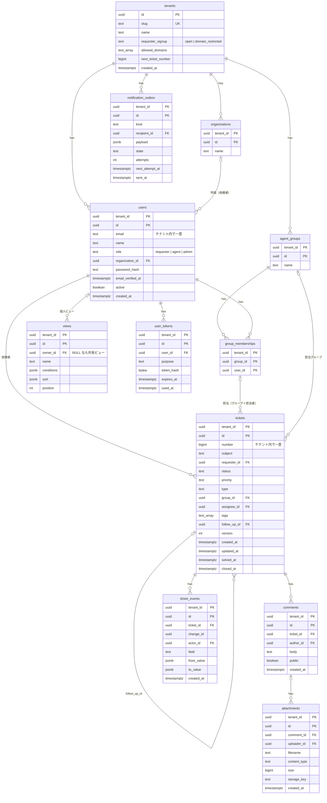

# データモデル設計

- 版: v0.1（2026-10-17）
- 前提: [要件定義書](../requirements.md) 6 章、[アーキテクチャ設計](architecture.md)

## 1. 方針

- 主キーは UUID とし、PostgreSQL 18 の `uuidv7()` で生成する。時刻順に並ぶため、B-tree インデックスの局所性が連番に近い。
- テナントのデータを持つ全テーブルは `tenant_id` を持ち、主キーを `(tenant_id, id)` とする。外部キーも `(tenant_id, 〜_id)` の複合キーで張り、テナントをまたぐ参照を DB が拒否する。
- 列挙値は PostgreSQL の enum 型ではなく `text` ＋ `CHECK` 制約にする。値の追加がマイグレーション 1 行で済み、Java の enum と名前を揃えやすい。
- 時刻は `timestamptz` で持つ。
- メールアドレスは小文字に正規化して保存する（アプリケーション側で変換）。

## 2. ER 図



## 3. テーブル定義

主要なテーブルの DDL を示す。最終的な定義は Flyway のマイグレーション（`backend/src/main/resources/db/migration`）とする。

### 3.1 テナント

```sql
CREATE TABLE tenants (
  id                 uuid PRIMARY KEY DEFAULT uuidv7(),
  slug               text NOT NULL UNIQUE CHECK (slug ~ '^[a-z0-9][a-z0-9-]{1,30}[a-z0-9]$'),
  name               text NOT NULL,
  requester_signup   text NOT NULL CHECK (requester_signup IN ('open', 'domain_restricted')),
  allowed_domains    text[] NOT NULL DEFAULT '{}',
  next_ticket_number bigint NOT NULL DEFAULT 1,
  created_at         timestamptz NOT NULL
);
```

- 予約語（`api`、`admin`、`signup` など）は slug に使えないよう、アプリケーションで検査する。
- チケット番号の採番（F-X-5）: `UPDATE tenants SET next_ticket_number = next_ticket_number + 1 WHERE id = :tenant RETURNING next_ticket_number - 1`。チケット作成と同じトランザクションで実行する。同一テナントのチケット作成はこの行ロックで直列化されるが、想定規模（エージェント 50 人以下）では問題にならない。番号に欠番が出ない。

### 3.2 ユーザー・グループ・所属組織

```sql
CREATE TABLE users (
  tenant_id         uuid NOT NULL REFERENCES tenants(id),
  id                uuid NOT NULL DEFAULT uuidv7(),
  email             text NOT NULL,
  name              text NOT NULL,
  role              text NOT NULL CHECK (role IN ('requester', 'agent', 'admin')),
  organization_id   uuid,
  password_hash     text,                  -- 招待を受諾するまで NULL
  email_verified_at timestamptz,
  active            boolean NOT NULL DEFAULT true,
  created_at        timestamptz NOT NULL,
  PRIMARY KEY (tenant_id, id),
  UNIQUE (tenant_id, email),               -- F-X-4: 別テナントなら同じアドレスを使える
  FOREIGN KEY (tenant_id, organization_id) REFERENCES organizations(tenant_id, id)
);

CREATE TABLE agent_groups (               -- group は予約語のため agent_groups とする
  tenant_id uuid NOT NULL REFERENCES tenants(id),
  id        uuid NOT NULL DEFAULT uuidv7(),
  name      text NOT NULL,
  PRIMARY KEY (tenant_id, id),
  UNIQUE (tenant_id, name)
);

CREATE TABLE group_memberships (
  tenant_id uuid NOT NULL,
  group_id  uuid NOT NULL,
  user_id   uuid NOT NULL,
  PRIMARY KEY (tenant_id, group_id, user_id),
  FOREIGN KEY (tenant_id, group_id) REFERENCES agent_groups(tenant_id, id) ON DELETE CASCADE,
  FOREIGN KEY (tenant_id, user_id)  REFERENCES users(tenant_id, id)
);
```

- グループに所属できるのはエージェントと管理者だけとする。ロールは別テーブルの列なので CHECK 制約では表せず、アプリケーションで検査する。

### 3.3 チケット

```sql
CREATE TABLE tickets (
  tenant_id    uuid NOT NULL REFERENCES tenants(id),
  id           uuid NOT NULL DEFAULT uuidv7(),
  number       bigint NOT NULL,
  subject      text NOT NULL CHECK (length(subject) BETWEEN 1 AND 250),
  requester_id uuid NOT NULL,
  status       text NOT NULL CHECK (status IN ('new', 'open', 'pending', 'on_hold', 'solved', 'closed')),
  priority     text NOT NULL CHECK (priority IN ('low', 'normal', 'high', 'urgent')),
  type         text NOT NULL CHECK (type IN ('question', 'incident', 'problem', 'task')),
  group_id     uuid,
  assignee_id  uuid,
  tags         text[] NOT NULL DEFAULT '{}',
  follow_up_of uuid,
  version      int NOT NULL DEFAULT 0,
  created_at   timestamptz NOT NULL,
  updated_at   timestamptz NOT NULL,
  solved_at    timestamptz,
  closed_at    timestamptz,
  PRIMARY KEY (tenant_id, id),
  UNIQUE (tenant_id, number),
  FOREIGN KEY (tenant_id, requester_id) REFERENCES users(tenant_id, id),
  FOREIGN KEY (tenant_id, group_id)     REFERENCES agent_groups(tenant_id, id),
  -- F-T-6: 担当者は担当グループに所属していること。assignee_id が NULL なら検査されない（MATCH SIMPLE）。
  -- 所属を外したら担当者だけを外す。
  FOREIGN KEY (tenant_id, group_id, assignee_id)
    REFERENCES group_memberships(tenant_id, group_id, user_id) ON DELETE SET NULL (assignee_id),
  FOREIGN KEY (tenant_id, follow_up_of) REFERENCES tickets(tenant_id, id),
  -- MATCH SIMPLE は列のどれかが NULL だと検査しないため、担当者がいるならグループも必須にする
  CHECK (assignee_id IS NULL OR group_id IS NOT NULL),
  -- 要件 7 のうち、行単体で判定できる規則
  CHECK (status <> 'new' OR assignee_id IS NULL),
  CHECK (status NOT IN ('solved', 'closed') OR assignee_id IS NOT NULL),
  CHECK ((status IN ('solved', 'closed')) = (solved_at IS NOT NULL)),
  CHECK ((status = 'closed') = (closed_at IS NOT NULL))
);
```

- ステータス遷移の規則はドメイン層（[アーキテクチャ設計 2.5](architecture.md#25-ステータス遷移)）で判定する。上の CHECK 制約は、ドメイン層の誤りがデータを壊さないための最後の防御である。
- 担当グループと担当者の整合性（F-T-6）は複合外部キーで保証する。担当者を所属グループから外すと、その担当者が担当するチケットの `assignee_id` は自動で NULL になる。その結果ステータスと担当者の CHECK 制約に反する場合（解決済みチケットなど）は、所属解除がエラーになる。アプリケーションは、所属解除の前に該当チケットの有無を確認し、利用者に知らせる。
- チケットの本文は最初の公開コメントとして `comments` に保存する（要件 6 章）。一覧には件名だけを表示する。
- 依頼者の返信や自動クローズで更新されたときも `updated_at` と `version` を更新する。

### 3.4 コメント・添付

```sql
CREATE TABLE comments (
  tenant_id  uuid NOT NULL,
  id         uuid NOT NULL DEFAULT uuidv7(),
  ticket_id  uuid NOT NULL,
  author_id  uuid NOT NULL,
  body       text NOT NULL CHECK (length(body) BETWEEN 1 AND 65536),
  public     boolean NOT NULL,
  created_at timestamptz NOT NULL,
  PRIMARY KEY (tenant_id, id),
  FOREIGN KEY (tenant_id, ticket_id) REFERENCES tickets(tenant_id, id),
  FOREIGN KEY (tenant_id, author_id) REFERENCES users(tenant_id, id)
);

CREATE TABLE attachments (
  tenant_id    uuid NOT NULL,
  id           uuid NOT NULL DEFAULT uuidv7(),
  comment_id   uuid,                        -- コメントに紐付くまで NULL
  uploader_id  uuid NOT NULL,
  filename     text NOT NULL,
  content_type text NOT NULL,
  size         bigint NOT NULL CHECK (size BETWEEN 1 AND 20971520),
  storage_key  text NOT NULL UNIQUE,
  created_at   timestamptz NOT NULL,
  PRIMARY KEY (tenant_id, id),
  FOREIGN KEY (tenant_id, comment_id)  REFERENCES comments(tenant_id, id),
  FOREIGN KEY (tenant_id, uploader_id) REFERENCES users(tenant_id, id)
);
```

- `comments` は追記のみ（F-C-2）。実行用の DB ロールに UPDATE / DELETE 権限を与えない。
- `attachments` は、コメント作成時に `comment_id` を 1 回だけ設定する（`WHERE comment_id IS NULL AND uploader_id = :viewer_user`）。

### 3.5 監査ログ

```sql
CREATE TABLE ticket_events (
  tenant_id  uuid NOT NULL,
  id         uuid NOT NULL DEFAULT uuidv7(),
  ticket_id  uuid NOT NULL,
  change_id  uuid NOT NULL,                 -- 1 回の更新で変わった項目をまとめる
  actor_id   uuid,                          -- NULL はシステム（自動クローズなど）
  field      text NOT NULL,                 -- status, priority, type, group, assignee, tags, subject, created, comment など
  from_value jsonb,
  to_value   jsonb,
  created_at timestamptz NOT NULL,
  PRIMARY KEY (tenant_id, id),
  FOREIGN KEY (tenant_id, ticket_id) REFERENCES tickets(tenant_id, id),
  FOREIGN KEY (tenant_id, actor_id)  REFERENCES users(tenant_id, id)
);
```

- 「誰が・いつ・何を・何から何に」（F-L-1）を 1 項目 1 行で記録する。画面では `change_id` 単位にまとめて表示する。
- 担当者やグループは ID と表示名の両方を `from_value` / `to_value` に入れる（例: `{"id": "...", "name": "佐藤"}`）。あとで名前が変わっても、当時の表示を再現できる。
- コメントの追加も `field = 'comment'`、`to_value = {"id": ..., "public": true}` として記録し、チケット画面の時系列表示で使う。
- 追記のみ（F-L-2）。実行用の DB ロールには SELECT / INSERT だけを与える。

### 3.6 ビュー

```sql
CREATE TABLE views (
  tenant_id  uuid NOT NULL,
  id         uuid NOT NULL DEFAULT uuidv7(),
  owner_id   uuid,                          -- NULL なら共有ビュー（管理者が作成）
  name       text NOT NULL,
  conditions jsonb NOT NULL,
  sort       jsonb NOT NULL,
  position   int NOT NULL DEFAULT 0,
  PRIMARY KEY (tenant_id, id),
  FOREIGN KEY (tenant_id, owner_id) REFERENCES users(tenant_id, id) ON DELETE CASCADE
);
```

- 要件 6 章の `shared` 列は持たず、`owner_id IS NULL` を共有ビューとする。2 つの列が矛盾する状態を作らないため。
- 標準ビュー（F-V-1）はテーブルに保存せず、コードで定義する（ID は `builtin:my-unsolved` などの固定値）。テナント作成時に行を複製する必要がなく、定義の変更が全テナントに即時に反映される。

`conditions` の形式（API とフロントエンドでも同じ形を使う）:

```json
{
  "all": [
    { "field": "status",   "op": "in",     "value": ["new", "open", "pending"] },
    { "field": "assignee", "op": "eq",     "value": "@me" },
    { "field": "tags",     "op": "has_any", "value": ["vpn"] },
    { "field": "updated_at", "op": "within_days", "value": 7 }
  ]
}
```

- `field` と `op` は許可リストで検証し、SQL の列名と演算子へ対応づける。利用者の入力を SQL の識別子に直接使わない。値はすべてバインド変数にする。
- `@me`（自分）と `@my_groups`（自分の所属グループ）は、実行時に閲覧者から値を決める。

### 3.7 トークン・通知

```sql
CREATE TABLE user_tokens (
  tenant_id  uuid NOT NULL,
  id         uuid NOT NULL DEFAULT uuidv7(),
  user_id    uuid NOT NULL,
  purpose    text NOT NULL CHECK (purpose IN ('invitation', 'email_verification', 'password_reset')),
  token_hash bytea NOT NULL UNIQUE,         -- SHA-256。生の値はメールにだけ載る
  expires_at timestamptz NOT NULL,
  used_at    timestamptz,
  PRIMARY KEY (tenant_id, id),
  FOREIGN KEY (tenant_id, user_id) REFERENCES users(tenant_id, id)
);

CREATE TABLE notification_outbox (
  tenant_id       uuid NOT NULL,
  id              uuid NOT NULL DEFAULT uuidv7(),
  kind            text NOT NULL,            -- ticket_created, public_comment, assigned, invitation など
  recipient_id    uuid NOT NULL,
  payload         jsonb NOT NULL,           -- テンプレートに渡す値（チケット番号、件名、コメント本文など）
  state           text NOT NULL DEFAULT 'pending' CHECK (state IN ('pending', 'sent', 'failed')),
  attempts        int NOT NULL DEFAULT 0,
  next_attempt_at timestamptz NOT NULL,
  sent_at         timestamptz,
  created_at      timestamptz NOT NULL,
  PRIMARY KEY (tenant_id, id),
  FOREIGN KEY (tenant_id, recipient_id) REFERENCES users(tenant_id, id)
);
```

- `user_tokens` は、トークンからテナントとユーザーを引く唯一の入口であり、トークンのハッシュで検索する。

## 4. インデックス

要件 N-1（一覧・詳細 500ms 以内）と N-2（全文検索 1 秒以内）を、10 万件のテナントで満たすためのもの。

```sql
-- 一覧・標準ビュー
CREATE INDEX tickets_status_updated   ON tickets (tenant_id, status, updated_at DESC);
CREATE INDEX tickets_assignee_status  ON tickets (tenant_id, assignee_id, status);
CREATE INDEX tickets_group_status     ON tickets (tenant_id, group_id, status);
CREATE INDEX tickets_requester        ON tickets (tenant_id, requester_id, updated_at DESC);
CREATE INDEX tickets_updated          ON tickets (tenant_id, updated_at DESC);
CREATE INDEX tickets_tags             ON tickets USING gin (tags);
-- 自動クローズの対象検索
CREATE INDEX tickets_solved_at        ON tickets (solved_at) WHERE status = 'solved';

-- 詳細画面
CREATE INDEX comments_ticket          ON comments (tenant_id, ticket_id, created_at);
CREATE INDEX ticket_events_ticket     ON ticket_events (tenant_id, ticket_id, created_at);
CREATE INDEX attachments_comment      ON attachments (tenant_id, comment_id);

-- 全文検索（pg_bigm）
CREATE INDEX tickets_subject_bigm     ON tickets  USING gin (subject gin_bigm_ops);
CREATE INDEX comments_body_bigm       ON comments USING gin (body gin_bigm_ops);

-- 送信ジョブ
CREATE INDEX outbox_pending           ON notification_outbox (next_attempt_at) WHERE state = 'pending';
```

- pg_bigm のインデックスには `tenant_id` を含められないため、全テナントの行から一致を探してからテナントで絞り込む。想定規模（10 テナント × 10 万件）では許容範囲と見込み、F-D-2 の 10 万件データで計測して確かめる。足りなければ `btree_gin` で `tenant_id` を複合インデックスに含める。
- 一覧のページングはオフセット方式とする。任意の列で並べ替える要件（F-V-3）があり、キーセット方式は列ごとに実装が要るため。深いページの性能は計測で確かめる。

## 5. マイグレーションとデータ投入

- Flyway のバージョン付きマイグレーション（`V1__init.sql` …）で管理する。
- デモデータ（F-D-1）と 10 万件の生成（F-D-2）は、マイグレーションではなく `devtools` のコマンドで投入する（`./gradlew :backend:bootRun --args='--seed=demo'` など）。本番相当の環境に誤って入らないようにするため。
